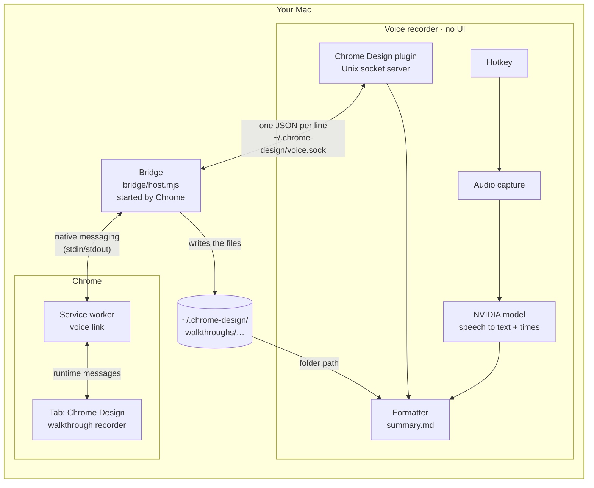
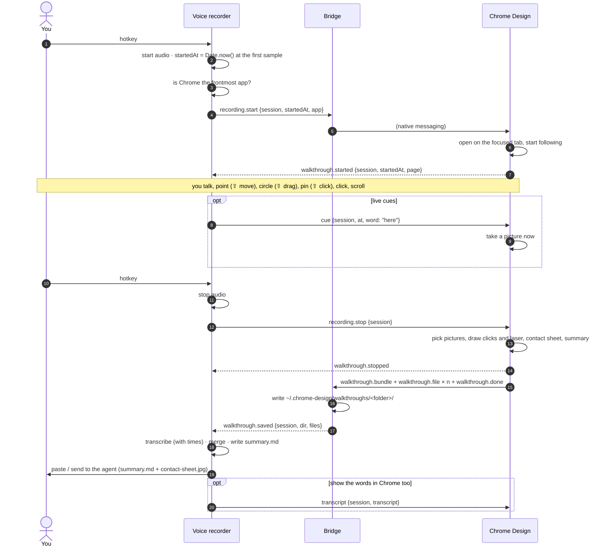
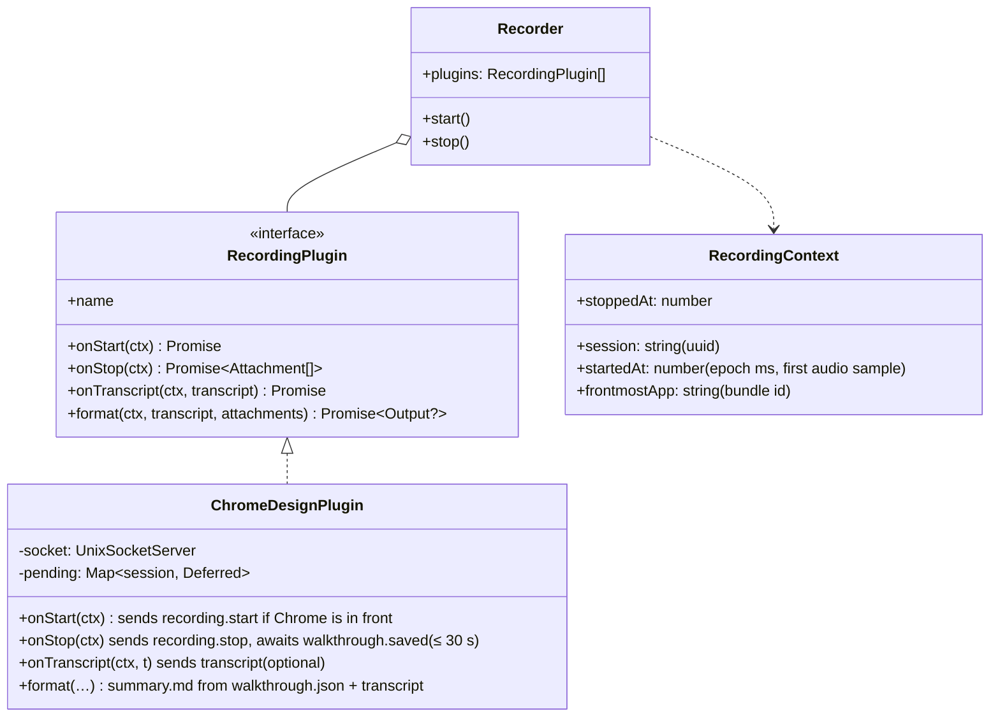

# Walkthroughs and the voice link

A **walkthrough** is Chrome Design following along while you talk through a page: where you
pointed, what you circled, underlined or pinned, what you clicked and scrolled, as numbered
pictures on one clock. A **voice recorder** (your own speech-to-text app) adds what you said.
Together they make one message for an AI agent, the way [Scrawl](https://github.com/kitlangton/scrawl)
does, without Chrome Design ever touching audio.

The two apps stay separate and each works alone:

| | Chrome Design alone | Voice recorder alone | Linked |
| --- | --- | --- | --- |
| Start | `W`, More → Walkthrough | its hotkey | either one starts both (the recorder only when Chrome is in front) |
| Pictures, marks, clicks | ✓ | – | ✓ |
| What was said | drop in any transcript (.srt, .vtt, .json, .txt) and line it up with the **Voice starts** dial | ✓ | lined up exactly, by clock |
| Final text for the agent | `summary.md` / Copy for AI | its own | the recorder writes it (or Chrome Design does, from the transcript the recorder sends back) |

## How the pieces connect



- **Chrome Design** (the extension) records the walkthrough and builds the pictures. It never
  records audio.
- **The bridge** is a ~200-line Node program that Chrome itself starts (Chrome's *native
  messaging*: the only way an extension can talk to a program on the computer). It relays
  messages between Chrome and the recorder and saves finished walkthroughs to disk, so the
  recorder only reads a folder. It lives in this repo (`bridge/host.mjs`); the recorder doesn't
  need to know Chrome's message format.
- **The voice recorder** gets one small plugin: a Unix socket server that speaks the messages
  below. Everything else (audio, the model, formatting) it already has.

Why this shape:

- Chrome extensions can't open sockets or start programs. Native messaging is the sanctioned
  way, and only a host registered for this extension's ID can be reached.
- Chrome starts the bridge, not the recorder, so the recorder can be any app in any language
  and can come and go. The bridge reconnects every 2 s, and keeps finished walkthroughs on disk
  if the recorder is down.
- While the bridge is connected, Chrome keeps the extension's service worker alive, so a
  hotkey in the recorder reaches Chrome instantly.
- Everything stays on the computer. The socket is user-only (`0600`).

## One recording, start to finish



If Chrome isn't in front, or Chrome Design can't run on that page, Chrome answers
`walkthrough.unavailable {reason}` and the recorder simply carries on with audio only.

Started from Chrome instead (`W`): Chrome sends `walkthrough.started` with `origin: "extension"`.
The recorder may start recording audio then; when Chrome stops, it sends `walkthrough.stopped`
with `origin: "extension"` and the recorder stops too.

## What to add to the voice recorder

The recorder has no plugins yet. The smallest version that keeps it a plain, UI-less
speech-to-text app: give it a **recording-lifecycle plugin interface** and write Chrome Design
as the first plugin. Other plugins later (screen capture, a terminal session, an iPhone) fit the
same hooks.



Checklist:

1. **A clock.** `startedAt` is `Date.now()` (Unix epoch milliseconds) when the *first audio
   sample* is captured, not when the hotkey was pressed. Chrome Design uses the same clock, so
   this alone lines the words up with the pictures.
2. **Timestamps from the model.** Ask the NVIDIA model for segment (or word) times. With NeMo /
   Parakeet that's `model.transcribe([...], timestamps=True)`: `output[0].timestamp['segment']`
   gives `{start, end, segment}` in seconds. Write them as Chrome Design's transcript format
   (below), or hand over NeMo's JSON as is: the parser reads `timestamp.segment`,
   `timestamp.word`, Whisper's `segments`, SRT and VTT.
3. **The socket server** at `~/.chrome-design/voice.sock` (or `$CHROME_DESIGN_VOICE_SOCKET`):
   remove a stale file, listen, `chmod 600`. One client connects (the bridge). Send
   `hello` on connect. Messages are JSON objects, one per line (`\n`).
4. **Frontmost check.** Before `recording.start`, check that the frontmost app is a Chromium
   browser (macOS: `NSWorkspace.shared.frontmostApplication?.bundleIdentifier`, e.g.
   `com.google.Chrome`). Chrome double-checks (`onlyIfChromeInFront`, default `true`).
5. **On stop:** send `recording.stop`, then wait for `walkthrough.saved` (give up after ~30 s and
   keep the audio-only result). The folder holds `walkthrough.json`, `summary.md` (without
   speech), `contact-sheet.jpg` and `frames/frame-NN.jpg`.
6. **Format:** merge the transcript and write the final `summary.md` (see *Formatting* below).
7. **Deliver** the way the recorder already does: e.g. the clipboard (summary text + the
   contact sheet as an image) or straight into an agent session with both attached.
8. Optional: **cues.** If transcription streams, send `cue` when you hear "here", "look",
   "this" or "watch" (Scrawl's cue words): Chrome takes a picture at that moment.
9. Optional: **send the transcript back** (`transcript`), so Chrome's review panel and its Copy
   for AI show the words too.

`bridge/example-recorder.mjs` does all of this except audio, in ~200 lines of Node (type a line
while "recording" to fake speech). Use it to try the loop before touching the real recorder.

## Messages

All times are Unix epoch ms. `session` is any unique string (a UUID) chosen by whoever starts.

Recorder → Chrome Design:

| type | fields | |
| --- | --- | --- |
| `hello` | `app`, `version?`, `protocol: 1` | on connect; `app` is shown in Chrome ("Sent to …") |
| `recording.start` | `session`, `startedAt`, `app?`, `onlyIfChromeInFront?` | follow along on the focused window's tab |
| `recording.stop` | `session`, `stoppedAt` | finish and send the walkthrough |
| `recording.cancel` | `session` | stop and keep nothing |
| `cue` | `session`, `at`, `word` | optional: take a picture now |
| `transcript` | `session`, `transcript`, `app?` | optional: the words, for Chrome's review panel |
| `status` | | Chrome answers `status {recording, session?}` |

Chrome Design → recorder:

| type | fields | |
| --- | --- | --- |
| `hello` | `extension`, `version`, `protocol` | when the link connects |
| `walkthrough.started` | `session`, `startedAt`, `origin`, `page {url, title}` | `origin: "extension"` = started in Chrome |
| `walkthrough.unavailable` | `session`, `reason` | can't follow along (not in front, restricted page, tab gone…) |
| `walkthrough.stopped` | `session`, `stoppedAt`, `origin` | |
| `walkthrough.bundle` | `session`, `folder`, `dir`, `files` | the bridge has started writing `dir` |
| `walkthrough.saved` | `session`, `dir`, `files` | **the one to act on**: everything is on disk |
| `walkthrough.discarded` | `session` | after `recording.cancel` |

(Between Chrome and the bridge the bundle travels as `walkthrough.bundle` with the JSON inside,
one `walkthrough.file` per picture (base64) and `walkthrough.done`; the bridge turns those into
files and `walkthrough.saved`.)

### Transcript format

Any of SRT, VTT, Whisper JSON or NeMo JSON works. Chrome Design's own, which says when the audio
started (so nothing needs lining up by hand):

```json
{
  "kind": "chrome-design.transcript",
  "startedAtMs": 1792332000123,
  "segments": [
    { "t0": 1200, "t1": 3400, "text": "This heading is too big,",
      "words": [{ "t0": 1200, "t1": 1450, "text": "This" }] }
  ]
}
```

`t0` / `t1` are ms from the start of the audio; `words` is optional.

## Formatting (what the agent reads)

`summary.md`, after Scrawl's format: one line per picture with what happened and what was said
during it, and everything else nested under the picture it happened in.

```text
[walkthrough 0:42 · Pricing · https://acme.test/pricing]
Recorded 2026-10-19 12:08 · window 1440×900
Pictures: contact-sheet.jpg (numbered #1–#6), full size in frames/. Red ink, numbered red pins and the red laser trail are the reviewer’s marks; blue rings are clicks.
Voice: Parakeet · lined up by clock. Quotes are what was said at that moment.

- #1 (0:00) start “So this is the pricing page.”
- #2 (0:04) pointed at Heading “Simple pricing” “This heading,”
- #3 (0:06) circled Heading “Simple pricing” “it is way too big.”
- #4 (0:11) pin 1 on Button “Start free”
- #5 (0:12) [clicked Button “Start free”] “And this does nothing.”
  · 0:13 typed in Field “Email”
- #6 (0:14) after the click
```

The rules (`src/walkthrough/summary.ts`, pure TypeScript with no dependencies):

1. **Moments** are the pictures, in time order; a picture's moment is when its mark began (the
   pen went down) or the click happened. With no pictures, marks and clicks are the moments.
2. **Speech** is split into clauses (at `, ; : . ? !`, using word times when there are any,
   otherwise spread over the segment by length). Each clause goes to the moment that was on when
   the clause *ended*, so a sentence started just before you circle something belongs to the
   circle.
3. **Everything else** (other marks, scrolls, typing, page changes) is listed under the moment
   it happened in, as `· m:ss what`.

Three ways for the recorder to produce it:

- **Call the command** (Node 22.6+): `node tools/walkthrough-merge.ts <folder> <transcript.json>`
  writes `<folder>/summary.md`. Add `--json` to put the transcript into `walkthrough.json` too.
- **Import the module** if the recorder is JS/TS: `alignTranscript` + `buildSummary` from
  `src/walkthrough/summary.ts`, `parseTranscript` from `src/walkthrough/transcript.ts`.
- **Port it** (~250 lines) if the recorder is Swift or Python: the three rules above, plus
  `describeEvent` for the nested lines. `walkthrough.json` already has every description
  written out (`marks[].description`), so the port is only arranging lines.

## `walkthrough.json`

Defined in `src/walkthrough/model.ts`. Times are ms since `startedAtMs`; positions are CSS px
from the top left of the page.

| field | |
| --- | --- |
| `startedAt`, `startedAtMs`, `durationMs` | the clock |
| `page {url, title}`, `viewport` | where |
| `session {id, app?, audioStartedAtMs?}` | when a recorder was involved |
| `frames[]` | `index`, `file`, `t` (the moment), `takenAt`, `reason` (`start`, `mark`, `pin`, `laser`, `click`, `result`, `scroll`, `navigate`, `cue`, `idle`, `end`), `mark?`, `scroll`, `viewport`, `width`, `height`, `scale` (picture px per CSS px) |
| `marks[]` | `shape` (`circle`, `underline`, `line`, `arrow`, `pin`, `mark`, `laser`), `t0`, `t1`, `box`, `from?`, `to?`, `pin?`, `on {label, selector}`, `also[]`, `description`, `frame?` |
| `events[]` | `click`, `scroll`, `type` (the field, never the text), `navigate`, `resize`, `cue` |
| `strokes[]` | the raw ink and laser, `[x, y, ms]` points, with what was under them |
| `cursor[]` | `[t, x, y]`, up to 15 a second while it moved |
| `transcript?` | `segments` on the walkthrough's clock, `offsetMs`, `alignment` (`clock` or `assumed`) |

## Setting it up

1. Load the extension and note its ID (chrome://extensions, Developer mode).
2. `bridge/install.sh <extension id>` (add `chromium`, `brave`, `edge` or `arc` for another
   browser). It writes the native messaging manifest and a small launcher in `~/.chrome-design/`.
3. Chrome Design → More → Settings → **All settings** → **Voice recorder** on.
   Chrome asks once to *communicate with cooperating native applications*.
4. Run the recorder (or `node bridge/example-recorder.mjs`). Settings shows *Connected to …*.

Chrome Design follows a recording on the focused tab when it can run there: it's already open on
that tab, or **Images from other websites** is on (that permission lets it start on any page
without a click).

## Limits

- A walkthrough stays on one page. Single-page-app navigation is followed; a full page load ends
  it (the page's script goes away with it).
- Chrome allows two pictures a second, so pictures are taken at moments (marks, clicks, scrolls,
  page changes, cues), at most 20 are kept, and the toolbar hides for an instant each time.
- Pictures need the extension: on the demo page and in shared files the walkthrough has marks,
  clicks and words, but no pictures.
- Text typed into fields is never recorded, only which field; it can still show in a picture,
  so cover private parts with a Blur box first (it shows in the pictures as it does on screen).
